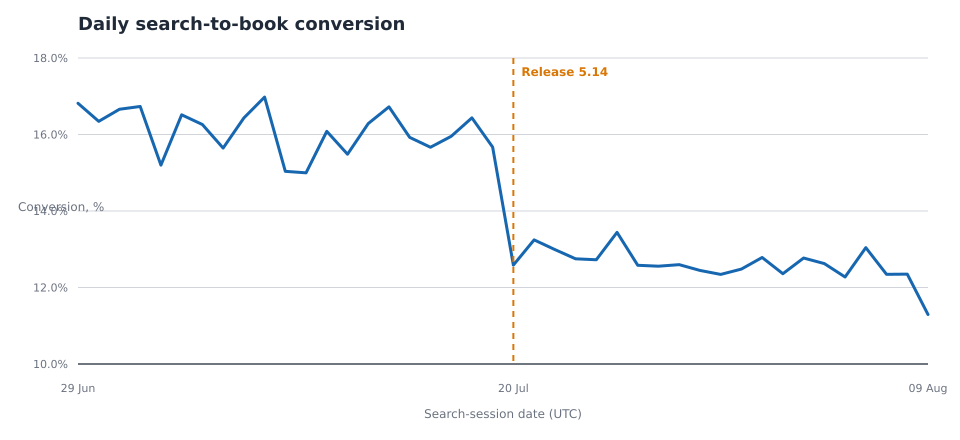

# Расследование падения search-to-book conversion

Самостоятельный portfolio-кейс продуктового аналитика: после rollout общая search-to-book conversion упала с **16,1% до 12,6% (-3,49 п.п.)**. Расследование показывает две одновременно верные вещи: основной вклад создаёт изменение mix трафика, а в узком Android-срезе есть сильный post-release сигнал, который нельзя игнорировать.

> Все данные здесь синтетические и воспроизводимо генерируются из кода. Это не данные Делимобиля и не данные какой-либо реальной компании. Лицензия кода и generated data — [MIT](LICENSE); внешние данные не используются.



## Бизнес-вопрос

Почему после rollout 20 июля 2026 года снизилась конверсия из search-сессии в бронирование — это проблема измерения, смена состава трафика, локальная регрессия продукта или несколько факторов сразу?

Короткий ответ: **агрегат нельзя объяснять релизом напрямую**. Mix effect равен -3,59 п.п., а within-cell effect в сумме +0,10 п.п.; в то же время Android × Moscow × paid_search × 5.14.0 падает примерно на 8,13 п.п. от pre-period. Последнее — сильная гипотеза инцидента, но before/after не доказывает causal effect.

Подробный отчёт: [reports/analysis_report.md](reports/analysis_report.md). Независимая финальная проверка: [reports/validation_report.md](reports/validation_report.md).

## Что внутри

```text
.
├── data/                 # описание synthetic inputs; большие CSV игнорируются
├── docs/                 # сценарий и data dictionary
├── notebooks/            # исполненный Jupyter companion
├── reports/              # отчёт, figures, таблицы и checks
├── scripts/              # генерация, анализ, report rendering, validation
├── sql/                  # funnel mart, decomposition и SQL quality checks
├── src/rca/              # генератор и pandas/DuckDB analytics
├── tests/                # ключевые расчёты и end-to-end smoke test
└── .github/workflows/    # lint, tests и reproducibility CI
```

## Воспроизводимый pipeline

Нужен Python 3.9+.

```bash
python -m venv .venv
.venv/bin/python -m pip install -r requirements.lock
make check
```

Для аудита чистоты артефактов (то же правило применяет CI) используйте `make check-determinism`: после полного pipeline не должно остаться ни diff tracked-файлов, ни новых неигнорируемых файлов. Исполненный notebook нормализуется, сохраняя outputs и удаляя runtime metadata; графики хранятся как детерминированные text-SVG, а не платформозависимые PNG.

Последовательность вручную:

```bash
.venv/bin/python scripts/generate_synthetic_data.py --output-dir data/generated
.venv/bin/python scripts/run_analysis.py --data-dir data/generated --output-dir reports
.venv/bin/python scripts/render_report.py --metrics reports/metrics.json --quality reports/quality_checks.json --output reports/analysis_report.md
.venv/bin/python scripts/validate_case.py --data-dir data/generated --reports-dir reports
.venv/bin/python -m jupyter nbconvert --execute --to notebook --inplace notebooks/conversion_drop_rca.ipynb --ExecutePreprocessor.timeout=180
.venv/bin/python scripts/normalize_notebook.py --notebook notebooks/conversion_drop_rca.ipynb
```

## Метод

- **Определение метрики.** Search-to-book = sessions with `booking_created` / sessions with `search_results_viewed`; одна строка на сессию в витрине.
- **Качество данных.** Проверяются uniqueness, nulls, порядок событий, daily coverage, join coverage и freshness. Результат сохраняется в `reports/quality_checks.json`.
- **SQL.** `01_create_funnel_mart.sql` агрегирует events и присоединяет dimensions/release calendar; `02_contribution_decomposition.sql` использует CTE, JOIN, aggregation и оконные функции для decomposition; `03_quality_checks.sql` проверяет event grain.
- **Python/pandas.** Загружает CSV, фильтрует события, делает `groupby` rollup и `merge` на session dimensions; далее независимый cross-check с DuckDB, статистический тест и графики.
- **Стандартизация.** `ΔCR = mix effect + within-cell rate effect` по взаимоисключающим `channel × session_quality` ячейкам. Так избегается average-of-averages и обнаруживается риск эффекта Симпсона.

## Практический вывод

1. P0: флагом отключить / откатить новый Android путь только для Moscow paid search; проверить availability, latency и error telemetry.
2. P1: добавить funnel instrumentation между выдачей и бронированием; мониторить standardized CR и distribution mix, а не только общий CR.
3. P2: после фикса провести pre-registered randomised holdback в затронутой популяции с primary metric search-to-book и quality guardrails.

Подробнее о метриках и полях: [docs/data_dictionary.md](docs/data_dictionary.md). О synthetic design и защите от leakage: [docs/scenario.md](docs/scenario.md).

## Ограничения

- Кейс демонстрирует метод и не является исследованием реального рынка или продукта.
- Параллельность во времени не равна причинности; version rollout не был случайным.
- Для causal решения нужны holdback/experiment и production telemetry о цене, наличии, latency и ошибках.
