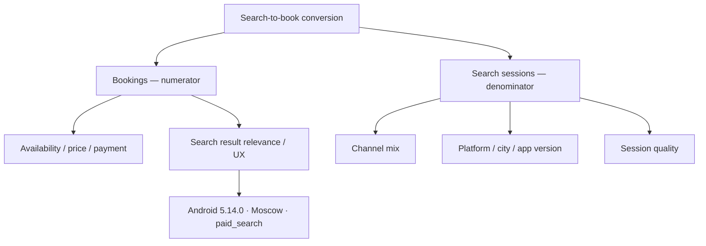
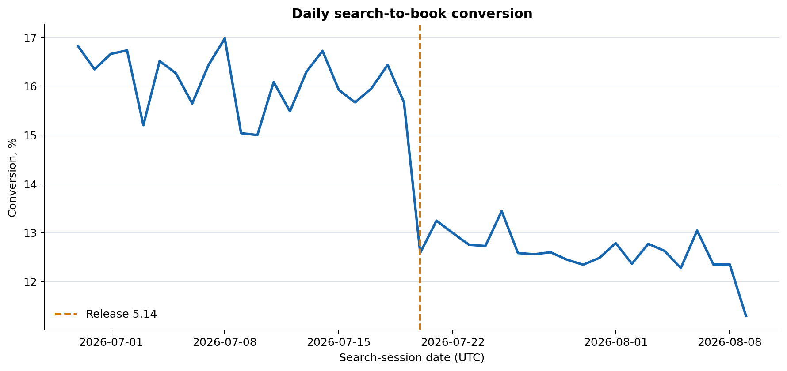
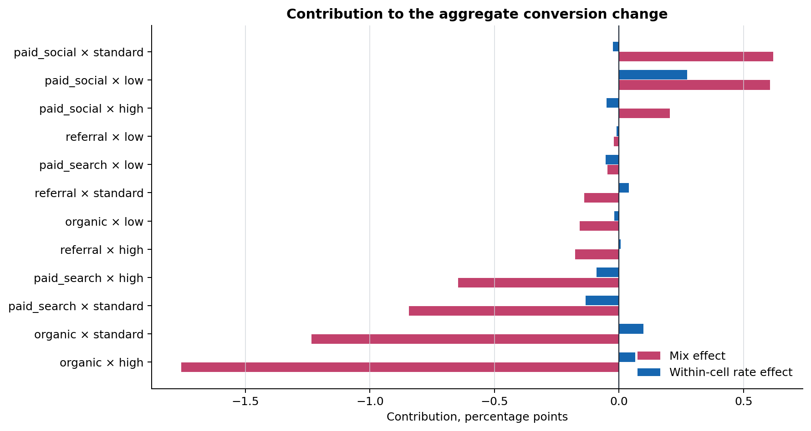
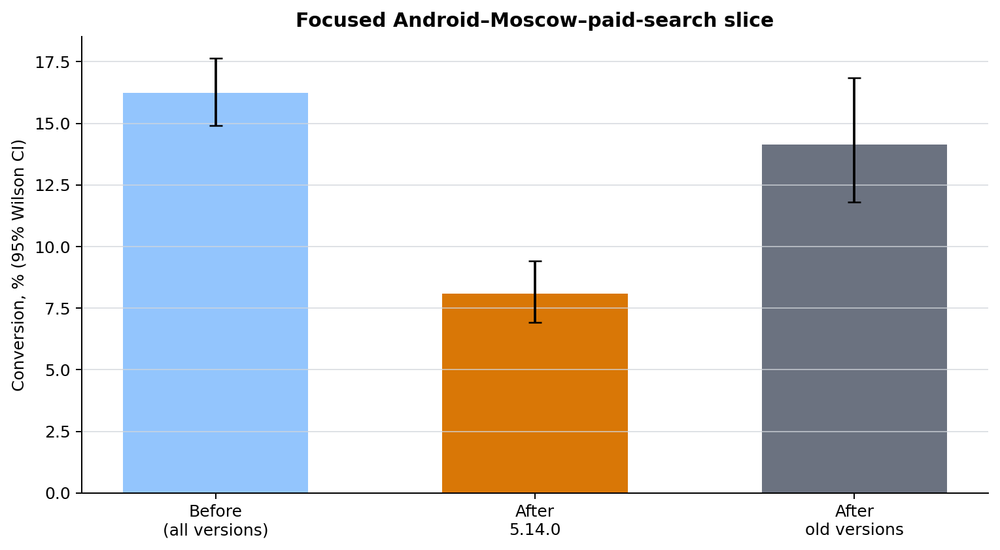

# Расследование падения search-to-book conversion

## Executive Summary

- **Верхнеуровневая метрика действительно снизилась:** с 16.1% (8,070 бронирований / 50,154 search-сессий) до 12.6% (7,370 / 58,472), то есть на -3.49 п.п..
- **Большая часть видимого падения — изменение состава трафика:** вклад mix равен -3.59 п.п., или 103.0% абсолютного topline-изменения. После релиза резко выросла доля low-quality paid social; агрегат нельзя приписывать релизу без стандартизации.
- **Есть локальный тревожный сигнал:** в заранее выделенном срезе Android × Moscow × paid_search показатель для версии 5.14.0 составил 8.1% против 16.2% до релиза (-8.13 п.п., 95% CI -9.99 п.п.…-6.28 п.п.; two-proportion test p < 0.001). Это приоритетная гипотеза инцидента, а не доказанный causal effect.
- **Данные пригодны для учебного RCA:** 8 проверок качества пройдено; SQL и pandas независимо воспроизводят conversion с максимальным расхождением 0.0e+00.

> **Статус источника.** Все данные в кейсе синтетические, детерминированно сгенерированы из кода. Они не являются данными Делимобиля или любой другой компании.

## Что измеряем и почему это важно

**Search-to-book conversion** = число search-сессий с хотя бы одним `booking_created` / число search-сессий с `search_results_viewed`. Гранулярность — сессия, а не событие: это защищает знаменатель от повторных просмотров выдачи. Окна равной длины: `2026-06-29 to 2026-07-19` и `2026-07-20 to 2026-08-09`. Временная зона — UTC (synthetic event timestamps).

## Сначала исключили проблему измерения

Проверка началась не с гипотезы о релизе: валидированы уникальность `event_id` и `session_id`, порядок search → booking, полнота дневных партиций, покрытие JOIN, отсутствие null в ключевых измерениях и freshness загрузки. Последняя загрузка отстаёт от synthetic as-of timestamp на 20.6 часа.

| Проверка | Статус | Правило |
|---|---|---|
| event_id_uniqueness | пройдено | 0 duplicate event_id values |
| session_key_uniqueness | пройдено | 0 duplicate session_id values in the session dimension |
| required_attributes | пройдено | 0 nulls in session-grain dimensions |
| event_order | пройдено | booking_created cannot precede search_results_viewed |
| join_coverage | пройдено | every session attribute row maps to exactly one funnel row |
| date_coverage | пройдено | no missing daily partitions in the analysis window |
| freshness | пройдено | latest ingestion is within 24 hours of the as-of timestamp |
| sql_event_grain | пройдено | SQL event-grain checks are all zero |

Это снижает риск, что падение создано дублями, сдвигом event grain, потерей JOIN или неполной последней датой. Оно не заменяет проверку production-инструментации в реальном продукте.

## Временная привязка: падение начинается около rollout

График показывает ежедневную session-weighted конверсию и дату начала rollout 20 июля. Временная близость делает релиз разумной гипотезой для проверки, но сама по себе **не доказывает причинность**: одновременно мог измениться канал, состав аудитории, спрос или доступность предложения.

## Mix shift объясняет большую часть topline-падения

Для взаимоисключающих ячеек `acquisition_channel × session_quality` выполнена decomposition:

`ΔCR = Σ(w_after − w_before) × CR_before + Σw_after × (CR_after − CR_before)`.

Первое слагаемое — composition/mix effect, второе — within-cell rate effect. Эффекты суммируются до общего изменения с ошибкой 1.4e-17.

| Сегмент | Mix effect | Within-cell effect | Доля сессий: before → after |
|---|---:|---:|---:|
| organic × high | -1.76 п.п. | +0.06 п.п. | 20.0% → 13.1% |
| organic × standard | -1.24 п.п. | +0.10 п.п. | 22.8% → 14.9% |
| paid_search × standard | -0.84 п.п. | -0.13 п.п. | 12.4% → 7.1% |
| paid_search × high | -0.65 п.п. | -0.09 п.п. | 6.2% → 3.8% |
| referral × high | -0.18 п.п. | +0.01 п.п. | 3.4% → 2.7% |

**Интерпретация.** Главный отрицательный вклад создаёт уход из высококонверсионных organic и paid-search ячеек. Paid social × low действительно вырос, но его небольшой положительный механический вклад не компенсирует потерю high-intent трафика. Поэтому агрегат нельзя читать как «релиз сломал всё»: это практическая ловушка эффекта Симпсона, когда взвешенная средняя меняет масштаб истории относительно сопоставимых сегментов.

## При этом локальный Android-срез требует немедленной проверки

Срез фиксирован по platform, city и channel; дополнительно проверен внутри pre-treatment прокси качества сессии. Падение присутствует во всех трёх quality-бакетах, что делает простую смену quality mix внутри этого узкого среза недостаточным объяснением.

| Качество сессии | Before CR | After 5.14.0 CR | Δ | 95% CI для Δ |
|---|---:|---:|---:|---:|
| high | 25.9% | 17.7% | -8.12 п.п. | -12.91 п.п.; -3.33 п.п. |
| standard | 16.4% | 8.2% | -8.19 п.п. | -10.91 п.п.; -5.47 п.п. |
| low | 5.8% | 0.7% | -5.13 п.п. | -7.01 п.п.; -3.25 п.п. |

Пострелизные старые Android-версии в том же geography/channel имеют CR 14.1%; это полезный diagnostic comparator, но не контрольная группа: rollout не был случайным, а версии могут отличаться по пользователям и устройствам. Поэтому p-value описывает совместимость разницы со случайной вариацией при выбранной модели, а не causal effect версии 5.14.0.

## Приоритетный план действий

1. **P0 — снизить риск:** feature flag / rollback нового search-result card только для Android × Moscow × paid_search; параллельно проверить error-rate, latency, availability и путь от search до booking. Сохранить holdback, если он уже есть.
2. **P1 — подтвердить механизм:** разобрать session replay / технические логи и добавить диагностические события: impression card, tap, availability response, price change, payment start/success. Проверить, не меняется ли пропуск событий после 5.14.0.
3. **P2 — исправить и измерить:** после фикса запустить заранее зарегистрированный randomised holdback в затронутой популяции, если переключатель доступен серверно. Primary metric — search-to-book; guardrails — crash-free sessions, search latency, availability response rate и booking cancellation.

## Мониторинг и confirmatory experiment

Ежедневно мониторить общий CR **и** standardized CR на pre-release mix, долю channel × quality, CR по platform × city × app version, а также freshness/duplicates/coverage. Алерт: падение standardized CR более чем на 1 п.п. за 24 часа при не менее 1 000 search-сессий и при пройденных data-quality checks; отдельный алерт для локального среза — более 2 п.п. от rolling-7-day baseline.

Для эксперимента с ожидаемым улучшением 2.0% относительно текущего 8.1% ориентир — около **3,237 search-сессий на вариант** (двусторонний α=0.05, power≈80%, независимые сессии). До запуска нужно скорректировать расчёт на кластеризацию по пользователю, фактическую baseline-конверсию и допустимые множественные проверки. Решение о rollout — только по заранее заданному primary metric и guardrails.

## Ограничения и открытые вопросы

- Это портфельный synthetic scenario: числа не являются внешним фактом и не должны использоваться для оценок рынка или продукта.
- Before/after и наблюдательный comparator не отделяют эффект релиза от календарного спроса, предложения, маркетинга и self-selection в rollout.
- В данных нет реальных логов availability, цены, ошибок и отмен; они нужны, чтобы подтвердить механизм, а не только место аномалии.
- Локальный тест — диагностический. При поиске по многим срезам p-values требуют pre-registration либо корректировки на multiple testing.
